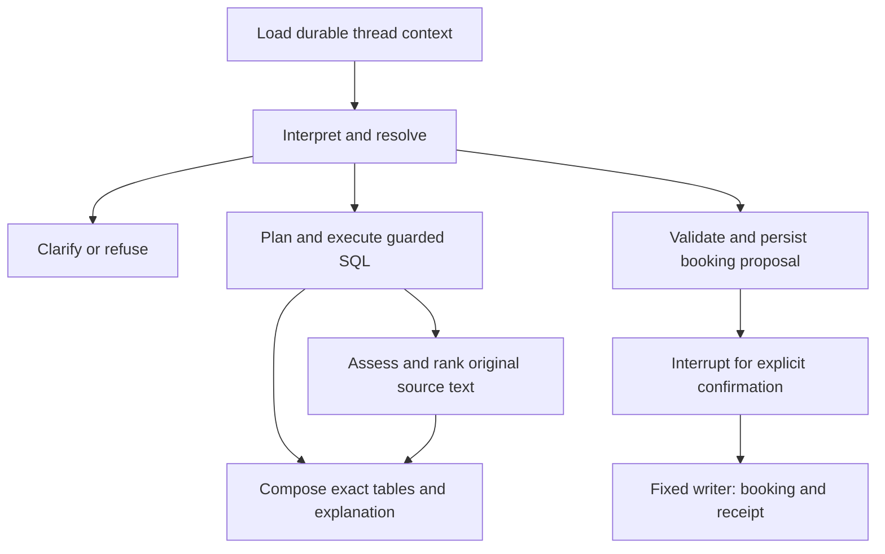
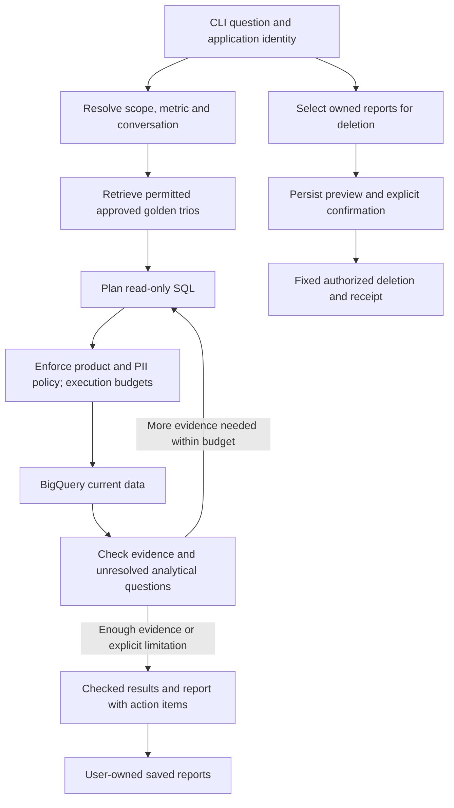

# Agent, text-to-SQL and RAG analysis

This document records the initial assignment/Resourcing comparison and architecture
recommendations, written before the retail implementation. Sources and inspection
limits: [catalogue](../reference/README.md). The subsequent interview selected LangGraph
and a bounded research loop. The implemented behavior is specified in the
[prototype contract](../specs/prototype.md), with concrete services in the
[production HLD](production.md). Historical recommendations below are context;
they do not override those contracts or imply a deployed production system.

## Main ideas

Resourcing Assistant helps a staffing manager query people, skills, capacity, project
risks and finances, find semantically suitable people/projects, and create one soft
booking after confirmation. The submitted solution is a local controlled workflow
with durable conversation state, API, React UI and explicit source evidence.

OpsFleet asks for an executive retail analyst: interpret an analytical question,
reuse approved analyst methodology, query current sales/customer/product facts,
discuss the results and write a report with actions. Product authorization and PII
safety apply throughout. Its only destructive operation is deleting owned saved
reports after confirmation; the transaction database remains read-only.

Both need more than text-to-SQL: interpretation, exact data, evidence, conversation,
error handling and a controlled action boundary. Their unstructured knowledge has
very different meaning.

## Requirement and implementation comparison

| Dimension | Resourcing brief and accepted implementation | OpsFleet assignment |
| --- | --- | --- |
| Main user | Staffing manager | Non-technical executive |
| Facts | Local mock PSA SQLite, 24 tables, 77,451 rows | BigQuery retail dataset and four named tables |
| Main reads | Skills, availability, staffing workflow, projects, time, finance | Sales, customer behavior, product performance, temporal comparisons |
| Text retrieval | Entity facts in bio, summary and risk description | Historical expert question/SQL/report trios guiding the analysis |
| SQL | Generated validated SQLite SELECTs; simple semantic eligibility can be compiled | Dynamic BigQuery SQL is required; analogous validation must be designed for that engine |
| LLM/framework | LangGraph and every generative step through typed DSPy; Azure models supplied | Framework is chosen and explained; Gemini preferred |
| State | Per-thread checkpoint, full transcript, exact pending actions; no cross-thread Store | Conversational prototype; user preferences and system learning in production design |
| Source mutation | One confirmed soft-booking INSERT; no updates/deletes | No analytical DB mutation; owned-report deletion in a separate library |
| Access model | One common dataset/local user; explicitly no auth or tenants | Each user can analyze only related products; no final-output PII |
| Interface | FastAPI and React; history and confirmation survive restart | CLI; no React/API requirement |
| Deployment | Local only, no service except the model endpoint | Concrete production HLD, services, compute and communication must be explained |
| Evaluation | Ten public plus at least ten own cases and scored README table required | Design of agent/report/intent/UX evaluation required; no prescribed gold file/count |
| Delivery emphasis | Inspectable agent, persistence, separated retrieval and safe write; actual UI/demo | Production design/explanation plus elegant prototype of four named requirements |
| Additional design | No external runtime orchestration/monitoring service | Golden updates, preferences, system improvement and no-redeploy persona updates |

The stack, lack of authentication, fixed April 2026 date and local-only services are
Resourcing-specific constraints/decisions. They must not become retail requirements.
The retail assignment's four mandatory prototype requirements do not remove its
working analysis/report/CLI capabilities. See [requirements](../specs/requirements.md).

## What Resourcing actually implements

The original brief requires Python 3.11+, LangGraph, DSPy, FastAPI, React and SQLite.
It requires factual answers with executed SQL; semantic ranked shortlists with
grounded reasons; and confirmed soft booking that still works after a process restart.
Source rows stay intact except confirmed booking inserts. Every model step must have
an explicit DSPy signature. Local execution may use no external runtime service
beyond the model endpoint. Its evaluation adds at least ten own cases to ten supplied.

The inspected implementation uses eight graph nodes: load_context, interpret, resolve,
read, match, compose, prepare and await_action. Logical read planning, execution,
assessment and ranking are delegated to services. There is no unrestricted tool loop.

SQL plans, interpretation, source assessment, ranking, project-field decomposition,
explanation and summarization are typed DSPy tasks. Dates, capacity, durations,
source lookups, rendering and transactional writes are ordinary validated code.
The LangGraph checkpointer preserves execution; app storage preserves complete
history; pending terms and receipts remain canonical outside model-written summaries.

## Text-to-SQL: existing mechanics and retail changes

### Existing factual path

1. Interpret the question and resolve exact IDs/codes or ask about genuine ambiguity.
2. Supply compact actual table/column/FK schema, bounded catalogue values, grain,
   units, status definitions and calculation rules. No expected answers are supplied.
3. Generate one primary query plus up to three additional independently complete
   queries, with named parameter records. A full total and top-N details are separate.
4. Execute on a dedicated read-only SQLite connection. The native authorizer enforces
   table/column/function permissions and denies writes, private tables, unsafe
   operations and extensions. Execute a single statement with time/row/byte limits.
5. Check selected output-scope/source mistakes and allow one shared planner repair
   for malformed output, syntax/schema or a detected supported scope error. No repair
   bypasses permission denial; valid empty results do not trigger repair.
6. Render numerical data and executed SQL in code. LLM explanation uses existing
   evidence; it does not replace arithmetic or compute missing totals.

`agent/reads.py`, `agent/read_policy.py` and `db/reader.py` implement these boundaries.
The reader observes physical source tables/columns; aliases alone do not establish
that the correct measure was read. Scope guards are targeted heuristics and not a
proof of arbitrary SQL semantics. The code still needs data-grounded evaluation.

### What changes for retail

Generated SQL remains appropriate for composable analysis, but swapping a database
client is insufficient. SQLite's native authorizer is not a transferable BigQuery
policy. The new boundary must restrict accessible datasets/tables, enforce permitted
products in every relevant source path before aggregation and prevent PII projection.
Restrict the underlying execution identity and validate model-proposed reads; merely
asking the model to append a WHERE clause does not establish these properties.

A concrete implementation should select an enforceable combination of permission-
scoped relations, execution permissions and SQL validation. This analysis does not
claim a particular authorized-view or per-user identity scheme has been implemented.
All report/history/RAG retrieval paths also need application ownership checks.

BigQuery scan cost and output size are separate concerns: LIMIT does not by itself
establish a scan budget. Plan validation/cost estimation and hard execution cost limits,
deadlines and bounded fetching are proposed requirements of the implementation design.
Do not materialize an unbounded DataFrame before applying the safety limits.

The semantic layer changes from capacity/minutes/FX rules to business metric contracts:
revenue definition, returns/cancellations, order-vs-item grain, customer cohorts,
repeat purchasing, churn definition, timestamp choice and comparable time windows.
These are not guaranteed by syntactically valid SQL. Live schema and data profiling
are still needed before finalizing these contracts.

The supplied BigQueryRunner only executes queries and retrieves schema. Its dataset
field does not confine SQL. It has no product scope, PII guard, query budget, bounded
repair, model, reports or trace context. See [starter facts](../reference/README.md).

## RAG: entity evidence versus analyst methodology

### Resourcing retrieves factual text about entities

Person documents contain bio plus role and skill names; exact proficiency remains
SQL evidence. Project documents expose summary and linked risks; risk documents expose
description. Current source text is short, so whole entity/field documents are used
rather than arbitrary chunking. Vectors are cached in local SQLite with text/model
hashes and source memberships; identical risk text keeps every linked risk/project ID.

Exact filters first establish eligible IDs. A recommendation can use vector candidates,
then model assessment and ranking. Requests for all/count instead visit the whole
eligible set in bounded batches. Assessments validate candidate IDs and quotations;
processed/matched/uncertain coverage is explicit. For projects, summary/industry and
risk conditions are assessed separately and joined to the correct parent with AND/OR.
This prevents provider business-unit HLS from substituting for healthcare clients.

Vector similarity proposes candidates; it establishes neither exact skill levels nor
a complete count. If embeddings fail, original-text assessment over the full eligible
set is possible but can take more time/calls. No match and unavailable retrieval are
different outcomes. Ranking decides order; public explanations retain checked source
assessment rather than trusting a new ranking rationale.

### OpsFleet retrieves expert analytical precedents

A golden trio is a precedent for how an analyst understood a question, selected a
metric, wrote SQL and interpreted a result. It is not a current transaction record
and its historical report numbers are not the answer to a new question.

Proposed runtime flow:

1. Resolve intent, metric, period and user product scope.
2. Search only permitted approved trios, using question meaning plus metadata such as
   metric, grain, schema/version, product scope and date. Keep each trio's parts linked.
3. Use the retrieved method/definitions to plan new SQL, adapting the period/filters
   and validating against the current schema and permissions.
4. Execute fresh BigQuery reads; compose the answer from those results. Reference
   the precedent for methodology and current queries for current numerical claims.
5. If no appropriate precedent exists, state the limitation or follow an explicitly
   approved fallback. Do not invent a golden example or execute retrieved SQL blindly.

Example: a historical state-to-state spending comparison may suggest decomposing
spend into active customers, order frequency and average basket. Its old values and
causal claims do not establish this quarter's result. A different metric definition,
schema or authorized product scope may make a superficially similar trio unsuitable.

Proposed update loop: candidate interaction/report -> human or defined expert review ->
PII/access review and versioned approval -> index update -> offline regression checks.
Feedback alone must not auto-promote an answer into trusted knowledge. Changed source
methodology must invalidate incompatible cached retrieval, not silently mix versions.

**Important naming trap:** Resourcing's `gold_questions.json` is evaluation input.
Its expected answers/SQL are kept outside runtime prompts. It is not the counterpart
of a Golden Bucket that deliberately supplies runtime analyst knowledge. Production
RAG examples and held-out evaluation cases must stay separate to avoid score leakage.

## Agent control and high-stakes actions

Resourcing's useful pattern is a controlled graph with typed model proposals and
fixed validated effects. Its booking writer accepts only a stored action ID and a
decision, revalidates terms/entities and commits booking plus receipt atomically.
Repeated Confirm returns the same result. A checkpoint is not the write receipt.

Retail can reuse that design principle for saved-report deletion, but the payload
and permissions change. Proposed sequence: identify owned reports -> determine the
complete matching set -> persist a previewed ID/version set -> explicitly confirm ->
revalidate ownership/versions -> execute fixed deletion and record the receipt.
Never regenerate a broader matching set after confirmation or accept arbitrary
model-authored DELETE SQL. Repeated decisions, rejection, stale proposals, mixed
ownership, a lost response and restart need defined outcomes. The selected prototype
removes reports from the library while retaining and explicitly explaining chat
history (DEC-12); it does not promise erasure of all copies.

DEC-15 selects case-insensitive literal phrase search over the full owned title/body
library, with no automatic alias inference. The old all/count-vs-top-k lesson still
applies: a nearest-neighbor shortlist cannot establish all matching reports. Semantic
matching or known client aliases are possible future changes, not selected prototype
behavior. Persist the exact previewed IDs rather than rerunning a broader search at
confirmation.

## Proposed retail flow and production responsibilities

Logical responsibilities for the future production HLD:

| Responsibility | What must be explained |
| --- | --- |
| Identity and product grants | Trusted user identity, grant lookup, enforcement and changes during a session |
| Orchestration/LLM | Typed intent/planning/explanation, bounded steps, provider failure behavior |
| Analytical storage | BigQuery permissions, safe relations, metric/schema context, cost and result limits |
| Golden corpus/index | Approved originals, linked trio metadata, permitted retrieval, versioning and updates |
| Application storage | User-owned history/reports, pending deletion terms, receipts and retention |
| User preferences | User-scoped presentation/depth preferences distinct from conversation and safety policy |
| System improvement | Reviewed feedback, failure datasets, controlled prompt/model changes and evaluation |
| Persona management | Non-developer editable versioned instructions, safe precedence and rollback |
| Observability | Correlated model/query/action steps, tokens, latency/cost, recovery and safe diagnostics |
| QA | Source-backed metric tests, authorization/privacy attacks, report grounding and CLI UX scenarios |

The final submission must choose concrete services/compute/stores and justify them;
this comparison is not that completed production HLD. A minimal prototype need not
run all production services or implement the four design-only requirements.

## Architecture judgement: workflow and tool-use autonomy

The existing Resourcing system is primarily a controlled LLM workflow with locally
model-driven choices, rather than an unrestricted ReAct loop. The model interprets
intent, writes SQL and assesses/ranks evidence, while code defines stage transitions,
data permissions and action execution. Calling it a bounded conversational agent is
reasonable, but framework naming alone does not establish autonomy or quality.
The [official LangGraph distinction](https://docs.langchain.com/oss/python/langgraph/workflows-agents)
separates predetermined workflows from agents that dynamically choose their tool use.
Both can use the same graph runtime. The [primary ReAct paper](https://arxiv.org/abs/2210.03629)
describes interleaving model reasoning/actions with observations; a modern tool loop
need not expose private chain-of-thought in product output.

For the Resourcing brief, the choice is defensible: exact factual questions, semantic
entity selection and one tightly controlled write have known stages, and durable
human confirmation is explicitly required. A tool-calling loop could also satisfy
that brief if its tools enforce the same rules. It would not remove validation,
complete semantic coverage, persistence, idempotency or evaluation work. No comparison
benchmark establishes that either variant would be better overall. The old system's
largest complexity concerns are accumulated domain-specific prompt/regex guards and
semantic special cases, not the existence of a graph itself.

For the retail flagship 'why' scenario, the initial linear SQL/report illustration
is insufficient as a complete agent contract. The first result may reveal that
customer count does not explain a difference; follow-up reads may need order frequency,
basket size, time periods or product mix. The revised conceptual flow above permits
bounded repeated analytical reads before composition. The subsequent interview
accepted this boundary; it does not promise causal identification.

Recommended boundary: model-selected analytical actions inside deterministic policy
and lifecycle control. Candidate capabilities include schema/metric discovery,
permitted golden-example search and guarded read-only SQL. Authorization, product
scope, PII policy, allowed actions, call/time/scan/output budgets, stop conditions and
confirmed report deletion are code-owned. The model may choose the next research
step, but may not override these boundaries or declare its own permission to delete.
Stop when evidence is sufficient or budgets are exhausted; return explicit limitations
instead of an endless investigation or an unsupported confident explanation.

An evidence check must distinguish successful execution from answering the question;
LLM self-assessment alone is not a correctness proof. Source-derived calculations,
metric contracts, deterministic invariants and held-out/paraphrase cases remain needed.
Start with one analytical agent; extra agent roles or a new query DSL have no current
requirement. The subsequent detailed spec selects LangGraph and numeric budgets.

## Data traps and reasoning lessons from Resourcing

| Observed source condition | Why it matters | Retail lesson |
| --- | --- | --- |
| 34 duplicated names / 68 people | A full name is not a safe write key | Product/client names need explicit identity, especially destructive matching |
| 2,095 bookings disagree with linked allocation person | Valid joins can represent the wrong relation | Confirm canonical paths and row grain rather than trust schema connectivity |
| Hard booking kind includes completed rows | Status and kind mean different things | Define revenue/return/order status semantics explicitly |
| WBS all-level hours are exactly 3x leaf hours | Rollups double/triple count | Orders x items and independent many-to-many measures need correct grains |
| Many rate cards per currency | A valid join multiplies costs | Aggregate/deduplicate the relevant dimension before joining |
| Provider HLS differs from client industry | A convenient structured proxy changes meaning | Product/customer segments and business dimensions cannot be substituted silently |
| 373 risks share ten descriptions | Deduplicating embeddings can lose entity memberships | Share indexed text while preserving report/product/source associations |
| Total booking minutes have no daily distribution | Cannot prove exact daily availability | Distinguish observed metrics from unavailable causal/explanatory data |
| No reliable invoice-to-project attribution | Some apparently natural questions lack a factual join | Refuse unsupported conclusions; do not invent data to satisfy an executive question |
| Gold query snippets omit parts of some answers | Reference SQL is not the full user intent | Evaluate the whole report: totals, comparisons, assumptions and action evidence |

A similar retail question, 'Why is state X underspending?', needs an agreed definition
and comparable cohorts. Useful decomposition is not proof of a causal effect; actions
should be framed as recommendations or hypotheses when the data cannot establish cause.
A churn question additionally needs an explicit inactivity/cohort definition.

## Evidence and limits of the old solution

Recorded runtime `23487e3` has one complete genuine-model 22-case run: 15 automatic
passes plus seven explicit run-bound AI-assisted source reviews. This is not an
independent human review, held-out score or repeated-run reliability estimate.
Backend tests, process restart and Chromium checks are recorded in the source repo;
they were inspected but not rerun during this task.

Two retained failures are particularly relevant. An earlier query used epoch interval
length instead of bookings.minutes: safe SQL, wrong metric. Another answer added
historical ACT-status years through ranking reasons: plausible prose, unsupported fact.
The fixes added a targeted physical-column provenance guard and restricted public
reasons to checked assessments. These failures demonstrate why schema access control
and successful execution alone do not prove analytical correctness.

Residual old-project limits include single-user access, one worker, fixture-specific
rules, English-oriented heuristic routing/output guards, growing local storage,
finite candidate ranking and no global monetary/per-request budget. Exact full scans
are finite but can still make many calls. Those defaults are not a production design
for retail. Some source specs retain future-tense/no-evidence wording even alongside
implemented-check links; inspected code and run-bound evidence must be distinguished
from such prose, not treated as a blanket guarantee.

## Reuse recommendation

Reuse the development harness, controlled orchestration principle, typed model task
boundaries, query provenance, bounded repair, exact computation, coverage metadata
and immutable confirmed-action/receipt pattern. Reuse test ideas, not fixture answers.

Redesign the SQL execution/security layer for BigQuery, product grants and PII; the
RAG corpus and retrieval objective; retail metric definitions; report ownership and
deletion; user preferences/learning; persona management and the production HLD.
Do not copy React, the 24-table schema, Azure deployment names, SQLite authorizer,
no-auth assumption, fixed April reference date or the entire old source tree merely
because they exist. LangGraph and DSPy may be considered, but are not mandated here.
