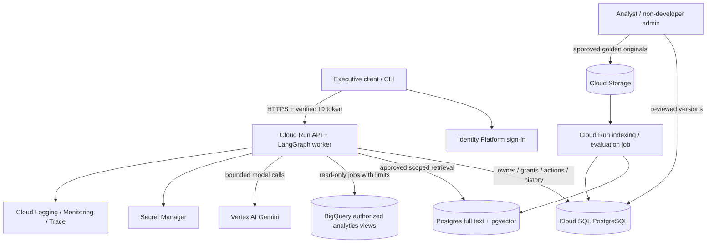

# Production HLD and technical explanation

This is a concrete proposed Google Cloud deployment of the agreed product, not a
claim that cloud infrastructure is deployed. The [prototype contract](../specs/prototype.md)
selects the smaller local implementation. [Original requirements](../reference/retail-assignment.txt)
and [accepted decisions](../decisions/README.md) remain the authority.

## Components, communication and persistence

Cloud Run hosts a small API/worker, avoiding Kubernetes administration for this load.
Identity Platform supplies end-user ID tokens; the API verifies them before owner/grant
lookup, never trusts a caller's user_id. [Official flow](https://docs.cloud.google.com/run/docs/authenticating/end-users).
Each request has an idempotent ID. The baseline bounds request/response investigation;
stream progress and return verified partial work when its budget ends. Longer work
requires an explicit continuation, rather than an unspecified background queue.
Scale instances with per-user admission and database locking,
not process-local locks. A 60s UX target is not the cloud request timeout.

Cloud SQL PostgreSQL owns users/product grants, conversations, execution/checkpoint
references, reports, actions/receipts, preferences, feedback, prompt/persona versions
and evaluation releases. Transactions keep report deletion and receipts together.
Use SQLAlchemy ORM/Core with short async sessions: commit/rollback and close around
an atomic use case, with no session held during model/warehouse calls. PostgreSQL
row locks/constraints replace SQLite-specific BEGIN IMMEDIATE for cost reservations
and destructive decisions; this production driver/locking integration is design-only.
Use backups/PITR and tested restore; define retention separately for history, reports,
audit and traces. Use SQL row ownership checks plus row-level security for owned app
records. DB/service credentials are in Secret Manager; private DB connectivity and
least-privilege service identities separate serving, indexing and administration.

Cloud Storage holds immutable original Golden trios and review artifacts with versions.
Cloud SQL stores metadata/full text/vectors and source links. pgvector is supported by
Cloud SQL; start here rather than another distributed database.
[Extension documentation](https://docs.cloud.google.com/sql/docs/postgres/extensions).
A Cloud Run job validates, redacts, embeds with a pinned Vertex embedding model and
indexes approved versions. App queries combine full text/vector similarity, metadata
(metric/schema/grain/freshness) and entitlements before candidate use. Persist retrieved
IDs/version/score for debugging; do not log confidential originals. Move to dedicated
vector infrastructure only if measured corpus/query load warrants it.

BigQuery remains transaction truth. Production service identity has job permission and
read access only to approved analytics relations, without raw PII table grants. View/
row policy and server-owned scope enforce product entitlements before aggregation.
The compiler remains an additional boundary: no caller/model query may choose raw
relations or authorization variables. A real private dataset can restrict underlying
access; the public demo dataset and demo user selector are not production IAM.

Vertex AI Gemini is the proposed production provider, keeping identity/operations in
Google Cloud; pin and evaluate the exact supported model at deployment. The prototype
uses the owner's OpenRouter key and pinned Gemini model instead. A thin provider
boundary is tool/JSON messages and validated outputs, not a custom agent framework.
No new provider fallback is silently introduced; fail or use verified partial results
unless an alternate model has separately passed evaluation and data handling review.

## Query-time flow

1. Verify identity, current grants, request/thread ownership and budget. Load versioned
   metric definitions, safe persona and bounded thread context. User preference affects
   formatting, not permissions or evidence rules.
2. Resolve an explicit period from the request/context or clarify. Retrieve approved
   method trios only from permitted metadata scope. Historical SQL/report guides the
   method; current numbers come from fresh database execution.
3. LangGraph performs bounded tool selection. Compiler enforces safe relations, source
   grain, support-count policy and bound user scope. Dry run estimates bytes; hard job
   and cumulative scan/cost ceilings stop execution regardless of model preferences.
4. Track executed query/job IDs and structured results. Check requested parts, metrics,
   coverage and limitations. Continue investigation if evidence is insufficient and
   budget remains. Distinguish facts, associated factors and causal hypotheses.
5. Render deterministic tables; generate grounded interpretation/actions. Scan output
   for sensitive material as defense in depth. Explicit report requests store immutable
   owned content/evidence; ordinary answers remain history.
6. Deletion prepares the full owned set and frozen hashes; confirmation revalidates
   current owner/grants and commits exact removal plus receipt. Never rerun the phrase
   against a larger set after confirmation. History/copies follow their separate policy.

## All eight requirements

| Requirement | Production mechanism | Prototype boundary |
| --- | --- | --- |
| Hybrid intelligence | Versioned approved Golden originals/index, ACL-aware hybrid retrieval, source-linked methodology | 3-5 educational trios; complete small-corpus model selection |
| Safety/PII | Trusted JWT/grants, restricted source relations, compiler, PII exclusion, support policy and output scanning | Two demo identities; real scoped query/result controls; no production auth claim |
| Destructive oversight | Frozen owned preview, explicit action ID, transactional deletion/receipt, audit/retry handling | Implement same protocol in local SQLite |
| User/system learning | Owned preference records and reviewed failure/feedback pipeline | Design only |
| Resilience | Bounded retry/repair, circuit-break/degraded status, job cancellation, idempotent effects, partial evidence | Local budgets, transient retry/repair and verified partial tables |
| QA | Data/metric oracles, adversarial tests, held-out reports, expert reviews and UX tasks | Deterministic local checks plus separately reported live eval |
| Observability | Correlated OpenTelemetry traces, Cloud logs/metrics, query IDs and prompt/model versions | Safe JSON logs, local rotation and persisted evidence |
| Persona agility | Non-developer admin editor, immutable versions, validation/evaluation, activate/rollback without deployment | Design only; fixed safety policy cannot be edited as persona |

## Learning, personas and release safety

Explicit user preferences are stored by user with provenance/version and can be
corrected/deleted. Inferred preferences need confidence and visible confirmation
before persistence; a new chat does not inherit another person's memory. Reports and
Golden examples do not authorize preference or policy changes.

System learning means controlled changes, not autonomous self-modification. Failures,
source-grounded expert corrections and feedback enter a review queue. Analysts create
candidate trios, verify SQL/metric/evidence, remove PII, assign scope/schema/freshness
and approve a version. Index job builds a new version. Offline held-out regression
and safety checks precede activation; retain rollback. Positive ratings alone cannot
promote a wrong report. Production Golden examples and evaluation answers stay separate.

A non-developer admin can edit presentation instructions through an authenticated
admin view backed by Cloud SQL. Load the active version on requests with short cache
TTL, so no redeploy is needed. Validate/preview the tone, run fixed report cases and
activate or roll back a version. Immutable code-owned safety, access, confirmation
and tool schemas always take precedence; persona changes cannot grant capabilities.

## Failure policy

Only transient network/429/5xx get bounded retries honoring short Retry-After. No retry
for auth/config/policy denial. One format/SQL correction preserves meaning; never make
an empty result nonempty by relaxing conditions. When Golden retrieval fails, expose
that missing context and use an approved metric-based fallback rather than fabricate
an expert precedent. If factual results exist but explanation/model fails, return
those exact results with an issue. Budget exhaustion is explicit and resumable with
user consent to another bounded turn. A transaction receipt determines deletion
success even if the response/checkpoint is lost. Provider outages do not erase history.

## Evaluation, UX and operations

Before deployment, use deterministic oracles for sums/counts/cohorts, mixed products,
UTC boundaries, threshold/ranking exceptions, SQL escapes and ownership. Evaluate
held-out questions/paraphrases, multi-step comparisons, ambiguous periods and missing
metrics. Human analysts review claim/evidence alignment, intent coverage, fact versus
hypothesis distinction and feasible action items; model judges are supplementary.
Track pass rates by scenario, numerical correctness, unsupported claims, retrieval
relevance, privacy/access violations and safe refusal/clarification rates. Require zero
known unauthorized reads/destructive effects in the tested adversarial set; this is
not proof against all attacks. Record dataset/prompt/model/index versions and costs.

UX evaluation asks executives to complete comparison, follow-up, report creation and
confirmed/rejected deletion tasks. Measure completion, correct understanding of scope/
period, clarification burden, waiting/drop-off and whether users understand that
library deletion retains chat history. Compare report readability and usefulness;
a fast syntactically correct SQL answer is not the acceptance criterion.

Dashboards: end-to-end and stage p50/p95 latency, errors by stage/code, repairs and
429s, scan bytes, tokens/spend, retrieval relevance/empty rate, query truncation,
clarification/partial/refusal rate and confirmation funnel/conflicts. Correlate request,
thread, model call, golden version, BigQuery job and action receipt. Alert on sustained
error/latency growth, budget burn or unexpected policy-denial spikes using volume-
aware baselines. Investigate with safe metadata and access-controlled owned evidence;
ordinary logs contain no raw prompts/results/PII/keys. Define retention and incident
access; replay reads against the recorded data version, never replay destructive calls.

## Delivery and limitations

Prototype setup is [documented separately](../development/setup.md); README will own
actual commands/example transcripts. This HLD is not provisioned, load-tested or costed
for an unspecified production volume. Authentication, vector indexing, admin editor,
learning jobs, production monitoring/retention/HA and broader SQL coverage are design
only. Exact deployment model, SLOs and capacity require measured workload and available
account/model versions. No cloud deployment, publishing or external message is authorized.
